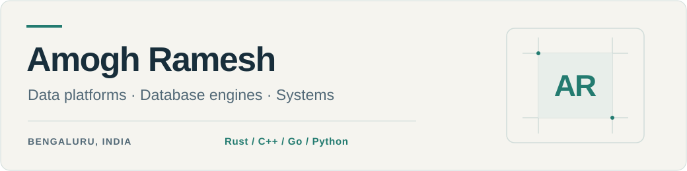

<picture>
  <source media="(prefers-color-scheme: dark)" srcset="assets/profile-dark.svg">
  <source media="(prefers-color-scheme: light)" srcset="assets/profile-light.svg">
  
</picture>

  <a href="https://www.ramogh.com"><strong>Portfolio</strong></a>
  &nbsp; / &nbsp;
  <a href="https://www.linkedin.com/in/ramogh2404/"><strong>LinkedIn</strong></a>
  &nbsp; / &nbsp;
  <a href="mailto:ramogh2404@gmail.com"><strong>Email</strong></a>

I build data platforms at **Texas Instruments** and contribute to **Apache DataFusion**. I started learning Rust to work on DataFusion; my contributions now cover its foreign-function interface, query optimiser and SQL behaviour.

## Contributions upstream

### Apache DataFusion
**Rust · Selected merged changes**

- **[Writable tables across FFI](https://github.com/apache/datafusion/pull/23906)** — Foreign table providers lost their write overrides. I forwarded delete, update and truncate operations, with regression tests through a dynamically loaded library.
- **[Arithmetic negation in the optimiser](https://github.com/apache/datafusion/pull/24668)** — Unary minus was being treated as bitwise complement. I removed the invalid rewrites and added optimiser and SQL regression tests.
- **[Aggregate null handling](https://github.com/apache/datafusion/pull/23908)** — Preserved null-handling support across FFI, testing both supported and unsupported cases.

[View all merged DataFusion contributions ↗](https://github.com/apache/datafusion/pulls?q=is%3Apr+author%3AAmogh-2404+is%3Amerged)

### dbt Spark adapter
**Python · [PR #2140 — open for review](https://github.com/dbt-labs/dbt-adapters/pull/2140)**

Adding `catalog.namespace.table` support across relation discovery, caching, incremental models and snapshots, with Spark/Iceberg compatibility tests.

## Selected projects

### [Tez ↗](https://github.com/Amogh-2404/Tez)
**C++17 · HTTP · Boost.Asio / Beast**

A compact HTTP server. Each connection owns its parser and buffers; session handlers preserve response order for pipelined requests. Includes request limits, file-access checks and real-socket protocol tests.

[Source](https://github.com/Amogh-2404/Tez) · [Architecture](https://github.com/Amogh-2404/Tez/blob/main/docs/architecture.md) · [Tests](https://github.com/Amogh-2404/Tez/tree/main/tests)

### [MiniLang ↗](https://github.com/Amogh-2404/minilang)
**C++ · LLVM 18 · Compilers**

A teaching compiler based on LLVM Kaleidoscope. My work includes constant-folding, dead-code elimination and loop-invariant code motion passes, with FileCheck tests for the transformed IR.

[Source](https://github.com/Amogh-2404/minilang) · [Architecture](https://github.com/Amogh-2404/minilang/blob/main/docs/architecture.md) · [Tests](https://github.com/Amogh-2404/minilang/tree/main/tests)

### [Split-ordered lists ↗](https://www.ramogh.com/work/split-ordered-lists)
**Go · Concurrency · Guided academic study**

Implemented a concurrent hash table with lazy bucket initialisation, compare-and-swap and two-phase deletion. The public write-up explains the design; the source is private.

---

I’d like to keep working closer to **database engines, storage and query execution**. If that’s what your team builds, [let’s talk](mailto:ramogh2404@gmail.com).
